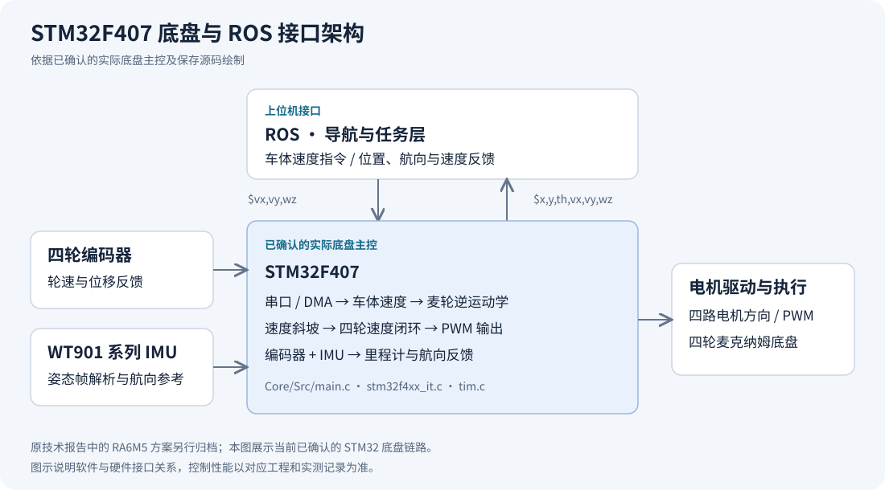
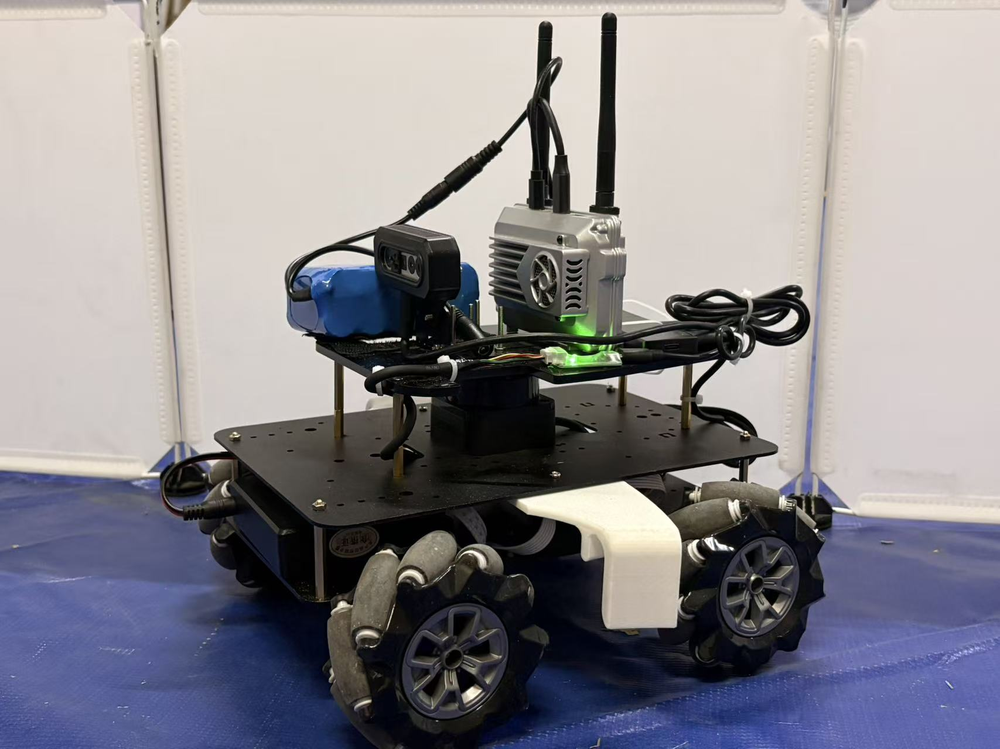
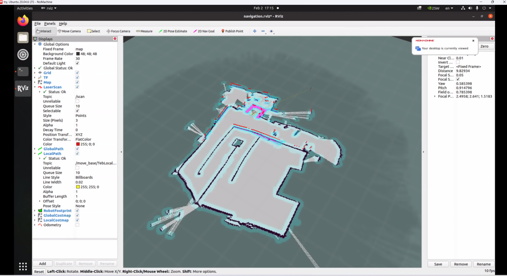

# RoboCup ROS 1 环境建图机器人

**RoboCup Environment Mapping Robot | ROS 1 · Gmapping · STM32F407 · RPLIDAR · RViz**

> 本项目聚焦移动机器人的二维环境建图，结合激光扫描、轮式里程计和 TF 坐标关系生成栅格地图。

## 🎬 项目展示 | Demo & Materials

[](./演示视频.mp4)

- [▶ 场地运行视频](./演示视频.mp4)
- [📄 技术文档：ROS 1 环境建图](./技术文档.pdf)
- [📝 技术文档 Word 可编辑版](./技术文档.docx)
- [💻 源码与模块导航](./src/README.md)
- [📦 下载重点代码压缩包](./重点代码压缩包.zip)

本页按项目本人确认的 **ROS 1 环境建图、STM32F407 底盘**整理。建图工作空间复用自「神思智飞」工程，当前收录与建图有关的底盘驱动、雷达驱动和 Gmapping 配置。

技术报告以「神思智飞」原技术说明与项目报告中的建图内容为底稿，并与当前源码交叉核对，涵盖系统组成、硬件模块、底盘通信、TF、Gmapping 参数、运行与地图保存方法。PDF 与 Word 版内容一致。

## 1. 项目概览 | Overview

机器人在场地内移动时，由激光雷达采集周围环境的二维距离信息，STM32F407 底盘通过编码器和 IMU 提供运动反馈。ROS 1 上位机发布里程计与 TF，将激光扫描输入 Gmapping，生成二维占据栅格地图，并通过 RViz 查看地图和传感器数据。

| 模块 | 主要职责 |
|---|---|
| **ROS 1 上位机** | 组织雷达、底盘、里程计、TF 与建图节点 |
| **Gmapping** | 利用激光扫描和里程计构建二维栅格地图 |
| **RPLIDAR** | 发布 `/scan` 激光数据，保存配置采用 C1 驱动入口 |
| **STM32F407** | 麦轮运动控制、编码器反馈、IMU 与里程计计算 |
| **RViz / map_server** | 地图查看及地图文件保存 |

## 2. 系统架构与核心代码 | Architecture & Code



```text
RPLIDAR → /scan ──────────────────┐
                                 ▼
编码器 / IMU → STM32F407 → ROS 1 底盘驱动
                         /odom + TF
                                 │
                                 ▼
                             Gmapping
                             /map + TF
                                 │
                         ┌───────┴───────┐
                         ▼               ▼
                       RViz          地图文件保存
```

| 模块 | 主要实现 | 源码入口 |
|---|---|---|
| 建图启动 | 底盘、雷达、Gmapping 与可选 RViz 的统一入口 | [mapping.launch](./src/ros1_ws/src/shensi_driver/launch/mapping.launch) |
| Gmapping 参数 | 坐标系、栅格尺寸、更新阈值与粒子数 | [my_gmapping.launch](./src/ros1_ws/src/shensi_driver/launch/my_gmapping.launch) |
| ROS 1 底盘驱动 | `rospy` 串口收发、`/cmd_vel`、`/odom`、TF 与诊断 | [base_driver.py](./src/ros1_ws/src/shensi_driver/scripts/base_driver.py) |
| 雷达与安装关系 | 雷达接入、底盘启动和静态 TF | [robot_bringup.launch](./src/ros1_ws/src/shensi_driver/launch/robot_bringup.launch) |
| 雷达驱动 | RPLIDAR 数据采集与 `/scan` 发布 | [rplidar_ros](./src/ros1_ws/src/rplidar_ros/) |
| MCU 主程序 | 运动学、IMU 解析、里程计与通信 | [main.c](./src/stm32f407-chassis/Core/Src/main.c) |
| 电机闭环 | 编码器反馈、速度斜坡与定时速度控制 | [stm32f4xx_it.c](./src/stm32f407-chassis/Core/Src/stm32f4xx_it.c) |
| MCU 工程 | Keil 与 STM32CubeMX 配置 | [Keil 工程](./src/stm32f407-chassis/MDK-ARM/test1.uvprojx) · [test1.ioc](./src/stm32f407-chassis/test1.ioc) |

### 目录结构

```text
.
├─ images/                    场地实物、地图截图与建图架构图
├─ src/
│  ├─ ros1_ws/                ROS 1 建图工作空间
│  ├─ stm32f407-chassis/       STM32F407 底盘工程
│  ├─ docs/                   环境、启动和材料说明
│  └─ archive/                底盘历史代码差异
├─ README.md                  项目展示页
├─ 技术文档.pdf                ROS 1 建图技术说明
├─ 技术文档.docx               技术报告可编辑原稿
├─ 演示视频.mp4                原始场地运行视频
└─ 重点代码压缩包.zip           建图工作空间与底盘源码
```

## 3. 工程内容 | Engineering Work

本项目为团队成果，当前按以下技术环节展示工程内容：

- **ROS 1 建图集成：** 接入激光扫描、底盘里程计与 TF，配置 Gmapping 地图构建链路。
- **底盘与里程计：** 使用麦轮运动学、编码器和 IMU 航向信息计算底盘状态，通过串口与 ROS 通信。
- **地图查看与保存：** 在 RViz 中查看 `/map`、`/scan` 与 TF，使用地图保存节点导出地图。

具体个人分工尚未单独确认，第三方建图算法与厂商驱动保留各自来源说明。

## 4. 项目展示与配置 | Mapping Demonstration

### 4.1 场地与机器人



整机照片来自「神思智飞」原项目报告，用于展示复用平台的麦轮底盘、分层安装结构与传感器布置。下方为 RoboCup 原场地视频截帧。

| 机器人近景 | 场地运行 |
|---|---|
|  |  |

原始视频约 1 分 33 秒，可查看机器人在箱体与挡板之间的移动过程。

### 4.2 RViz 地图界面



该图直接提取自「神思智飞」原项目报告。地图精度、覆盖率与运行耗时仍需对应地图文件、日志和实测记录说明。

### 4.3 保存的建图配置

| 参数 | 保存值 | 含义 |
|---|---|---|
| `delta` | `0.02 m` | 栅格尺寸 |
| `particles` | `30` | 粒子数 |
| `map_update_interval` | `1.0 s` | 地图发布更新间隔配置 |
| `linearUpdate` | `0.1 m` | 平移更新阈值 |
| `angularUpdate` | `0.1 rad` | 转动更新阈值 |

以上为源码配置值，不能解释为地图精度或实测性能。

## 5. 环境与运行 | Setup & Usage

参见[环境与运行说明](./src/docs/SETUP.md)。新增的 `mapping.launch` 汇总原底盘、雷达和 Gmapping 启动项，默认不启动 RViz。

## 6. 第三方依赖与致谢 | Third-Party Software

工程使用 ROS 1、Gmapping、RViz、`rplidar_ros`、STM32 HAL 与 CMSIS。
