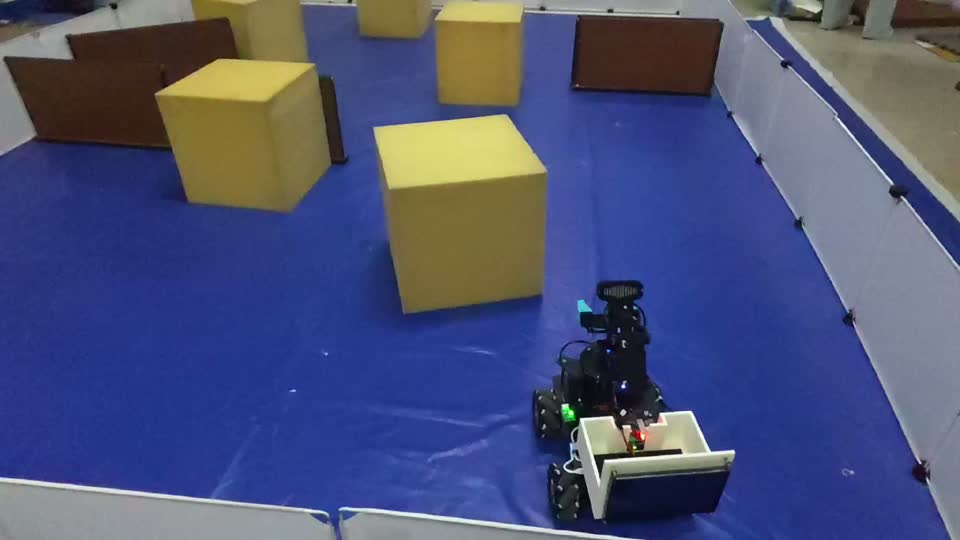
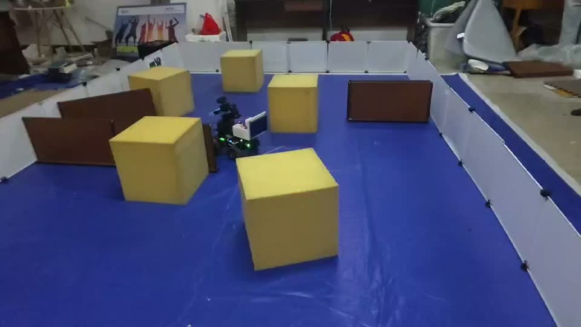
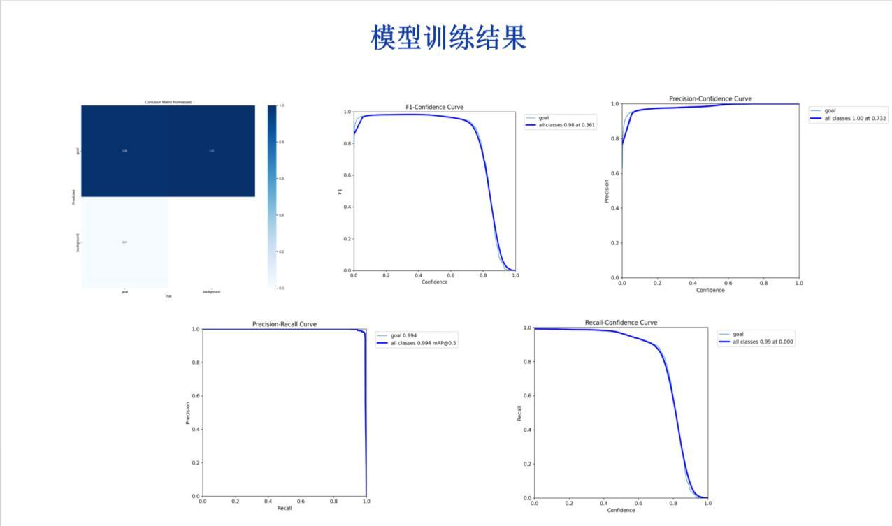

# RoboCup 自主探索与环境建图救援机器人

**RoboCup Autonomous Rescue Robot | RK3588 · RA6M5 · ROS 2 · SLAM · RKNN**

> 面向室内救援场景的团队机器人项目，展示环境探索演示、技术认证材料与移动操作平台工程。

## 🎬 项目演示 | Demo & Materials

[](./演示视频.mp4)

- [▶ RoboCup 场地运行视频](./演示视频.mp4)
- [📄 RoboCup 技术认证报告](./技术文档.pdf)
- [📊 RA6M5 平台参考答辩 PPT](./materials/平台参考答辩.pptx)
- [📋 RA6M5 平台技术报告](./materials/RA6M5平台技术报告.pdf) · [作品简介](./materials/RA6M5平台作品简介.pdf)
- [💻 源码与模块导航](./src/README.md)

> **展示版本：** 本页按材料完整度，以 **RK3588 + RA6M5 + ESP32** 平台资料为主要代码入口。RA6M5 源码与参考 PPT 来自自动捡球／体育馆服务平台资料；RoboCup 视频保留为 **STM32F407 实机记录**。平台功能与救援场景适配分别说明，详见[版本与验证范围](./docs/SETUP.md)。

## 1. 项目概览 | Overview

项目围绕未知室内环境中的探索、地图构建、导航和机器人任务执行展开。系统采用感知决策与实时控制分层的方式，将上位机视觉计算、下位机底盘控制及机械臂执行组织为相互连接的模块。

本仓库以救援技术报告和场地视频说明应用方向，同时收录材料更完整的 RA6M5 移动操作平台源码，提供视觉推理、三维定位、底盘通信、运动学和机械臂接口的代码入口。

| 平台 / 模块 | 主要职责 | 保存材料 |
|---|---|---|
| **RK3588 / ROS 2** | 视觉计算、传感器接口与导航配置 | `my_robot_core`、`robot_vision` |
| **RA6M5** | 麦轮运动学、编码器、PID、IMU 与里程计 | FSP / Keil 工程及完整业务模块 |
| **ESP32 / J1 机械臂** | 舵机通信、动作组与机械臂执行接口 | 厂商参考程序及 ROS 2 机械臂包 |
| **RGB-D 相机 / 激光雷达** | 深度目标定位与环境观测 | Orbbec / 思岚驱动与启动配置 |
| **STM32F407 历史底盘** | RoboCup 实机资料对应的底盘版本 | 原完整工程与版本对比归档 |

## 2. 系统架构与核心代码 | Architecture & Code


**系统功能结构图。** 提取自 RoboCup 技术报告第 6 页，展示 RK3588、RA6M5 与 ESP32 的分层方案。现有代码的场景和完成状态见下表及运行说明。

```text
RGB-D 相机 / 激光雷达
          │
          ▼
     RK3588 · ROS 2
     ├─ robot_vision：RKNN 推理、球体筛选、三维坐标
     ├─ my_robot_core：串口里程计、建图与导航配置
     └─ jibot1_driver：机械臂驱动与拾取接口
          │
     ┌────┴─────────┐
     ▼              ▼
RA6M5 麦轮底盘    ESP32 / J1 机械臂
运动学 / PID      舵机 / 动作组
IMU / 里程计      末端执行

main_control.py 当前为心跳框架，完整任务调度尚待完善。
```

### 核心模块与入口

| 模块 | 保存代码中的主要实现 | 源码 |
|---|---|---|
| RA6M5 主程序 | 10 ms 调度、速度命令、轮速处理、里程计与超时处理 | [hal_entry.c](./src/ra6m5_base/src/hal_entry.c) |
| 电机与闭环 | 四路 PWM / 方向控制、增量式 PID | [motor.c](./src/ra6m5_base/src/motor.c) · [pid.c](./src/ra6m5_base/src/pid.c) |
| 姿态与运动学 | WT901 帧解析、航向处理、编码器速度与位姿解算 | [imu.c](./src/ra6m5_base/src/imu.c) · [kinematics.c](./src/ra6m5_base/src/kinematics.c) |
| 硬件工程 | FSP 外设、引脚与 Keil 配置 | [configuration.xml](./src/ra6m5_base/configuration.xml) · [Led.uvprojx](./src/ra6m5_base/Led.uvprojx) |
| ROS 2 底盘接口 | 串口收发、速度指令、里程计 / TF 与诊断 | [base_driver.py](./src/ros2_ws/src/my_robot_core/my_robot_core/base_driver.py) |
| 视觉与端侧推理 | RKNNLite、YOLO 后处理、颜色 / 圆度筛选与 RGB-D 定位 | [npu_3d_tracker.py](./src/ros2_ws/src/robot_vision/robot_vision/npu_3d_tracker.py) |
| 建图与导航配置 | 硬件接入、SLAM 和导航启动资料 | [launch](./src/ros2_ws/src/my_robot_core/launch/) · [config](./src/ros2_ws/src/my_robot_core/config/) |
| 任务控制框架 | 节点启动与周期心跳 | [main_control.py](./src/ros2_ws/src/my_robot_core/my_robot_core/main_control.py) |
| ROS 2 机械臂 | 驱动、运动学与拾取放置接口 | [jibot1_driver](./src/ros2_ws/src/jibot1_driver/) |
| ESP32 参考固件 | J1 厂商舵机、串口和动作组程序 | [esp32_arm](./src/esp32_arm/) |

### 目录结构

```text
.
├─ README.md                 项目展示页
├─ 技术文档.pdf               RoboCup 技术认证报告
├─ 演示视频.mp4               原始场地演示视频
├─ materials/                RA6M5 平台报告、作品简介与参考 PPT
├─ images/                   原始视频画面与报告插图
├─ src/
│  ├─ ra6m5_base/            RA6M5 FSP / Keil 底盘工程
│  ├─ ros2_ws/src/           感知、底盘及机械臂 ROS 2 包
│  └─ esp32_arm/             J1 厂商参考程序
├─ docs/                     环境、资料对应及验证说明
└─ archive/                  STM32F407 历史工程及版本对比
```

## 3. 工程开发与贡献说明 | Contributions

本项目由团队合作完成，以下按可见材料梳理工程内容。个人主导与协作分工未在本次整理中另行确认。

**① 视觉感知与三维定位**

平台视觉节点使用 RKNNLite 执行 YOLO 推理，结合颜色、轮廓圆度和深度信息筛选球体并估计三维位置。该实现为球体感知路线，受困人员、急救包和危险标识检测仍需对应模型与场景适配。

**② RA6M5 底盘实时控制**

以 FSP 配置串口、定时器和引脚，在业务层实现麦轮运动学、编码器反馈、增量式 PID、IMU 航向解析及里程计回传。主程序包含通信超时清零和停止输出逻辑。

**③ ROS 2 与执行接口集成**

通过底盘串口节点衔接 `/cmd_vel`、`/odom` 与 TF，保存 SLAM / 导航配置和机械臂驱动入口。主任务节点目前仅有心跳框架，不能据此确认完整自主救援状态机已经实现。

**④ 平台扩展与版本追溯**

保留 RA6M5 平台工程、原始技术报告和参考 PPT，并归档 STM32F407 实机版本，便于分别追溯场地演示、平台功能与后续救援适配。

## 4. 项目实验与结果 | Experiments & Results

### 4.1 机器人实物与场地运行

| 机器人近景 | 障碍场地中的移动 |
|---|---|
|  |  |

**RoboCup 视频画面。** 分别取自约 `00:00` 和 `00:15`。原视频时长约 1 分 33 秒，展示机器人在箱体与挡板之间移动的过程。该实机记录按 STM32F407 版本保留，不作为 RA6M5 整机复测结果。

### 4.2 SLAM 建图与导航可视化


**RViz 可视化。** 提取自 RoboCup 技术报告第 8 页，可见地图、激光扫描和路径显示项。具体运行版本与复现效果需结合对应日志确认。

### 4.3 视觉模型训练资料



**训练结果资料。** 提取自报告第 7 页，图中类别为 `goal`。当前未附原始数据集、权重和评估明细，不将其解释为受困人员检测精度或板端推理速度。

### 4.4 材料与验证状态

| 内容 | 当前材料与范围 |
|---|---|
| RA6M5 底盘 | 完整保存工程、FSP 配置、五个核心业务模块与说明 |
| RK3588 / ROS 2 | 底盘驱动、视觉节点、机械臂接口与导航配置 |
| 模型与任务完成度 | RKNN 权重尚缺；主任务节点为心跳框架 |
| 平台参考 PPT | 19 页，原主题为体育馆捡球与服务，按原内容保留 |
| RoboCup 场地演示 | 原 MP4 及截帧；STM32F407 实机记录 |
| 控制与通信参数 | RA6M5 代码设定 10 ms 控制、20 ms 回传、500 ms 超时；本次未实测 |
| 救援场景与定量结果 | 暂无完整任务适配验收、完赛率或成功率原始统计 |

## 5. 环境与运行 | Setup & Usage

- [环境与版本说明](./docs/SETUP.md)：工程来源、构建入口、模型与设备配置、现有运行限制。
- [源码导航](./src/README.md)：RA6M5、ROS 2、ESP32 与历史 STM32 入口。
- [RA6M5 配置手册](./src/ra6m5_base/PROJECT_CONFIG.md) · [代码阅读说明](./src/ra6m5_base/README_LEARNING.md)。
- [图片与材料来源](./images/README.md)。

此次保留收录业务源码内容，完成目录与材料整理，未执行 ROS 2 / Keil 构建、模型推理或整机复测。

## 6. 第三方依赖与致谢 | Third-Party Software

工程涉及 ROS 2、Nav2、SLAM Toolbox、RKNNLite、Orbbec SDK、思岚雷达驱动、Renesas FSP / CMSIS，以及 J1 机械臂厂商参考程序。保留已有版权与许可，不将第三方算法或出厂程序作为团队独立原创成果。

感谢团队成员在机械结构、电气搭建、视觉算法、控制系统与整机联调中的合作。
