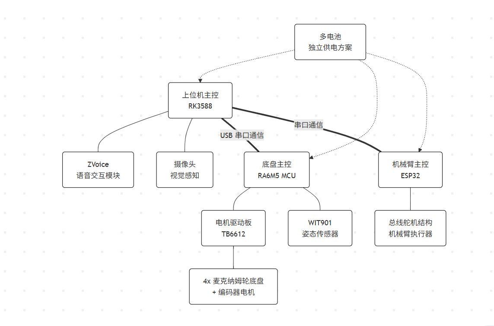
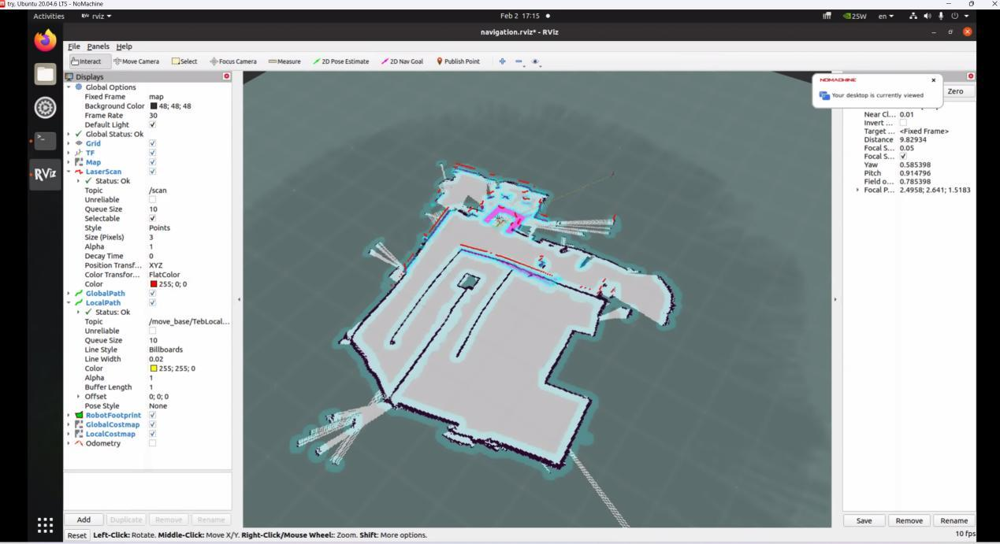

# RoboCup 自主探索与环境建图救援机器人

**RoboCup Autonomous Rescue Robot | ROS · SLAM · Autonomous Navigation · Embedded Control**

> 面向室内救援场景的团队机器人项目，整理自主探索演示、技术认证材料与底盘控制源码。

## 🎬 项目演示 | Demo

[](./演示视频.mp4)

- [▶ 查看完整演示视频](./演示视频.mp4)
- [📄 阅读技术认证文档](./技术文档.pdf)
- [💻 查看源码与模块导航](./src/README.md)
- [🔧 环境与版本说明](./docs/SETUP.md)

> **版本说明：** 技术报告描述 **RK3588 + RA6M5 + ESP32** 的救援系统；当前保存的底盘工程为 **STM32F407** 版本。两者分别展示，尚未据现有材料确认迁移关系。视频展示场地中的机器人运行，硬件型号、软件版本及完整救援流程不能仅由外观确定。

## 1. 项目概览 | Overview

本项目围绕救援机器人在未知室内环境中的探索、环境建图、导航与任务执行展开。移动平台采用四轮麦克纳姆底盘，结合上位机感知与规划、下位机实时控制，以及机械执行机构开展系统集成。

本仓库提供三类可直接查看的材料：**场地运行视频、系统技术报告，以及保存的 STM32 底盘工程**。页面依据各自材料说明功能与版本，便于分别了解整机方案和已有代码。

| 系统部分 | 主要职责 | 材料依据 |
|---|---|---|
| 感知与决策 | 场景感知、SLAM、导航和任务调度 | 技术报告中的 RK3588 / ROS 方案 |
| 底盘实时控制 | 麦轮运动学、编码器测速、速度闭环、IMU 与里程计 | 报告中的 RA6M5 方案；另保存 STM32F407 工程 |
| 机械执行 | 机械臂动作编排、轻量物资递送与近距处置 | 报告中的 ESP32 方案 |
| 交互与供电 | ZVoice 语音输入与多路独立供电 | 技术报告方案 |
| 场地运行 | 机器人在箱体及挡板组成的障碍场地中移动 | 原始演示视频 |

## 2. 系统架构与核心代码 | Architecture & Code

### 报告系统架构



**系统功能结构图。** 提取自技术报告第 6 页，展示 RK3588 感知决策、RA6M5 底盘控制、ESP32 机械执行及语音交互的分工。

```text
相机 / 语音输入 / 环境信息
              │
              ▼
      RK3588 · ROS 感知与决策
      建图 / 导航 / 目标识别 / 任务调度
              │
       ┌──────┴────────┐
       ▼               ▼
  RA6M5 底盘控制    ESP32 机械执行
  麦轮 / IMU / PID   动作编排 / 物资递送

以上为报告方案；当前发布的独立底盘源码为 STM32F407 版本。
```

### 已保存的核心代码

| 模块 | 源码中的主要实现 | 入口 |
|---|---|---|
| 主控与运动学 | ROS 速度指令解析、麦轮速度分解、轮速与 IMU 里程计 | [main.c](./src/stm32f407-chassis/Core/Src/main.c) |
| 速度控制 | 定时中断、编码器反馈、速度斜坡与四轮闭环 | [stm32f4xx_it.c](./src/stm32f407-chassis/Core/Src/stm32f4xx_it.c) |
| 编码器与 PWM | 定时器初始化及编码器读取接口 | [tim.c](./src/stm32f407-chassis/Core/Src/tim.c) |
| 串口通信 | ROS 与 IMU 串口、DMA 及外设配置 | [usart.c](./src/stm32f407-chassis/Core/Src/usart.c) |
| 硬件工程 | STM32CubeMX 配置与 Keil 工程 | [test1.ioc](./src/stm32f407-chassis/test1.ioc) · [Keil 工程](./src/stm32f407-chassis/MDK-ARM/test1.uvprojx) |
| 协议与接线 | 通信帧格式、硬件连接与调试说明 | [通信协议](./src/stm32f407-chassis/PROTOCOL_GUIDE.md) · [接线说明](./src/stm32f407-chassis/WIRING_GUIDE.md) |
| 历史对比 | 不同轮位映射和角速度计算版本 | [版本对比](./archive/README.md) |

技术报告第 12—18 页保留 RA6M5 `hal_entry` 主程序片段；当前材料中尚无完整 RA6M5 工程、对应 ROS 上位机工程和 ESP32 固件，未将报告代码片段重建为可编译工程。

### 目录结构

```text
.
├─ README.md                 项目展示页
├─ 演示视频.mp4               原始技术认证视频
├─ 技术文档.pdf               原始技术认证报告
├─ images/                   视频画面与报告插图
├─ src/stm32f407-chassis/     保存的底盘源码与硬件工程
├─ docs/                     环境、版本和验证范围说明
└─ archive/                  历史 main.c 与差异记录
```

## 3. 工程开发与贡献说明 | Contributions

本项目由团队合作完成。以下梳理技术报告和现有源码中的开发内容；个人主导、协作分工尚未单独确认，因此暂以团队工程内容展示。

**① 自主探索与导航系统集成**

围绕环境感知、地图构建、路径规划和目标点到达组织上位机功能，结合里程计反馈形成感知与运动控制链路。报告中的 ROS 地图与导航界面见[实验展示](#42-slam-建图与导航可视化)。

**② 麦克纳姆轮底盘控制**

保存的 STM32 工程包含四轮运动学、编码器反馈、速度斜坡与速度闭环，支持前后移动、横移和旋转的车体速度接口。核心实现位于 [main.c](./src/stm32f407-chassis/Core/Src/main.c) 和 [stm32f4xx_it.c](./src/stm32f407-chassis/Core/Src/stm32f4xx_it.c)。

**③ 姿态解析、里程计与通信**

解析 WT901 系列 IMU 数据帧，结合编码器位移更新底盘位姿；通过串口接收车体速度指令并返回位置、航向及速度。保存工程包含 DMA 通信、IMU 校验与归零、指令超时处理等实现。

**④ 救援执行与系统协同设计**

报告将任务组织为搜索、导航接近、底盘对位、机械执行和信息回传等阶段，采用独立控制器承担机械臂动作与底盘实时控制。该部分按报告方案展示，具体代码覆盖情况见[版本说明](./docs/SETUP.md#版本与材料对应)。

ROS、SLAM、厂商驱动及其他第三方组件遵循各自来源与许可，不作为团队独立原创算法成果。

## 4. 项目实验与结果 | Experiments & Results

### 4.1 机器人实物与场地运行

| 机器人近景 | 障碍场地中的移动 |
|---|---|
|  |  |

**视频画面。** 分别取自原视频约 `00:00` 与 `00:15`。视频时长约 **1 分 33 秒**，分辨率为 `1280 × 720`，可查看机器人在箱体与挡板之间移动的过程。是否全程自主、采用哪套控制器及地图覆盖率等信息仍需对应运行日志说明。

### 4.2 SLAM 建图与导航可视化



**RViz 可视化。** 提取自技术报告第 8 页，可见地图、激光扫描和路径相关显示项。该图按报告原始材料展示，未据此绑定当前发布的 STM32 固件或报告中的具体主控版本。

### 4.3 视觉模型训练资料


**报告训练结果图。** 提取自技术报告第 7 页，包括混淆矩阵、F1、Precision、PR 和 Recall 曲线。图中类别标记为 `goal`；当前材料未包含对应数据集、模型权重与评估明细，因此不将这些曲线解释为受困人员识别精度或板端推理性能。

### 4.4 已有材料与验证状态

| 内容 | 当前材料 | 展示范围 |
|---|---|---|
| 整机与场地运行 | 原始 MP4 视频及截帧 | 可查看实际运动过程 |
| 系统架构 | 报告功能结构图 | RK3588 / RA6M5 / ESP32 方案 |
| 建图与导航 | 报告 RViz 截图 | 地图及导航可视化资料 |
| 视觉训练 | 报告训练曲线 | 原图归档，不扩展为救援目标精度结论 |
| 底盘控制 | STM32F407 源码、CubeMX 与 Keil 工程 | 静态核对；本次未编译或实机复测 |
| 报告中的控制周期 | `10 ms` 控制、`20 ms` 回传、`500 ms` 超时 | 报告设计参数，不作为本次实测结果 |
| 完赛率、建图误差、任务成功率 | 暂无定量原始记录 | 待对应版本的测试数据补充 |

## 5. 环境与运行 | Setup & Usage

- [环境与版本说明](./docs/SETUP.md)：源码环境、运行前提、通信接口及材料差异。
- [源码导航](./src/README.md)：关键入口与源码整理范围。
- [底盘系统说明](./src/stm32f407-chassis/SYSTEM_GUIDE.md)：保存工程的模块与配置资料。
- [图片来源](./images/README.md)：视频时间点与报告页码。

本次整理保留原业务源码，移除了编译产物、个人 IDE 状态及重复工程副本。未执行 Keil 编译、上位机运行或实机复测。

## 6. 第三方依赖与致谢 | Third-Party Software

底盘工程包含 STMicroelectronics STM32 HAL、CMSIS 与器件支持文件，保留已有版权和许可证。报告涉及 ROS、SLAM、YOLO / RKNN、Renesas FSP 及相应厂商组件，其算法与软件权利归原作者或厂商所有。

感谢团队成员在机械结构、电气搭建、算法集成、底盘控制和整机联调中的合作。
